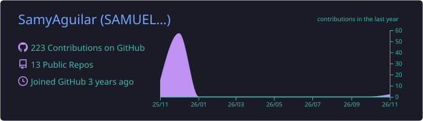
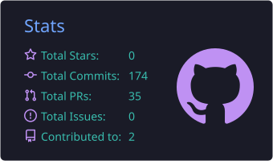
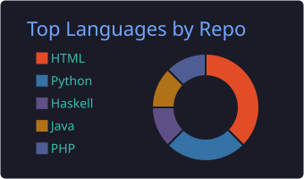
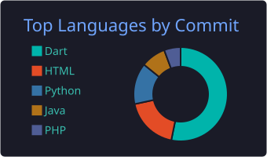

<h1 align="center">¡Hola! Soy Samuel Aguilar 👋</h1>
<h3 align="center">Estudiante de Ingeniería en Sistemas Computacionales · Desarrollador Full Stack & Mobile</h3>

  

---

## 🙋‍♂️ Sobre mí

- 🎓 Estudio **Ingeniería en Sistemas Computacionales**.
- 🔭 Actualmente trabajo en un **asistente virtual móvil con IA** para aprender lenguajes de programación.
- 🌱 Me interesa el desarrollo **full stack**, las **apps móviles** y el **análisis de datos / machine learning**.
- 👯 Busco colaborar en proyectos donde pueda compartir y adquirir nuevos conocimientos.
- 💬 Pregúntame sobre conceptos de programación.
- ⚡ Dato curioso: me encantan las galletas de chocolate 🍪

---

## 🛠️ Tecnologías y herramientas

**Lenguajes**

**Frontend & Mobile**

**Backend & Bases de datos**

**Datos & IA**

**Herramientas**

---

## 🚀 Proyectos destacados

| Proyecto | Descripción | Stack |
|---|---|---|
| 🤖 [**Asistente de Aprendizaje de Programación**](https://github.com/SamyAguilar/proyecto-asistente-AprendizajeProgramacion) | Asistente virtual móvil con inteligencia artificial para mejorar el aprendizaje de lenguajes de programación. Incluye app móvil, panel de administración y API. | Flutter · React · Node.js · Express · PostgreSQL · Gemini · Docker |
| 🦟 [**Proyecto Dengue Mortalidad**](https://github.com/SamyAguilar/ProyectoDengueMortalidad) | Sistema de análisis y visualización de datos epidemiológicos del dengue en México, con modelos predictivos para anticipar brotes en municipios de alto riesgo. | Python · Streamlit · scikit-learn · Pandas · Plotly · MySQL |
| 🧵 [**Web Textiles**](https://github.com/SamyAguilar/webTextiles) | Sitio web dedicado a los textiles oaxaqueños. | HTML · CSS · JavaScript |
| 🌧️ [**Lluvia de Palabras**](https://github.com/SamyAguilar/LluviaPalabras) | Juego web de palabras que caen como lluvia, con registro e inicio de sesión de usuarios y tabla de puntajes. API REST con autenticación JWT. | Java 17 · Spring Boot · Spring Security · JWT · JPA · MySQL/H2 · React · Vite |
| 🎨 [**Portafolio**](https://github.com/SamyAguilar/samyaguilar.github.io) | Mi portafolio de estilos y prácticas de programación web. | HTML · CSS · React |

---

## 📊 Estadísticas de GitHub

  

  
  
  

  

---

## 📫 Contacto

  

  

<i>⭐ ¡Gracias por visitar mi perfil! ⭐</i>

